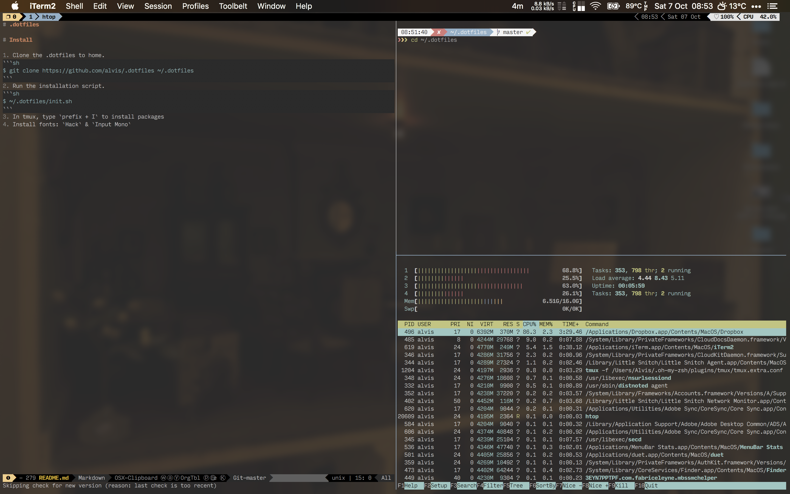

<div align="center">


# dotfiles

Awesome dotfiles for macOS and the PRO, along with powerful configurations for emacs, tmux and zsh.

[](LICENSE)

</div>

This repository sets up a Mac (or a Linux devcontainer) with one command: the
applications, developer tools, and the zsh, tmux, Git, and editor
configuration I use every day. Your own application settings follow you from
machine to machine through a private repository that only you own.



**Review before you run.** These are opinionated settings. Read the code,
keep what you like, and remove what you don't.

## Contents

- [Install](#install)
- [How it is organized](#how-it-is-organized)
- [Personal settings: your private `.configs`](#personal-settings-your-private-configs)
- [What syncs and what does not](#what-syncs-and-what-does-not)
- [Managing applications](#managing-applications)
- [How automatic sync works](#how-automatic-sync-works)
- [Conflicts](#conflicts)
- [Security](#security)
- [Migrating from Mackup](#migrating-from-mackup)
- [Recovery and rollback](#recovery-and-rollback)
- [Updating](#updating)
- [Platforms and limitations](#platforms-and-limitations)
- [Development](#development)
- [Git sweep](#git-sweep)

## Install

### Another Mac, when you already have a `.configs` repository

```sh
curl -fsSL https://raw.githubusercontent.com/alvis/.dotfiles/main/install.sh \
  | bash -s -- --config <github-user>/.configs
```

### Your first Mac

Add `--init`. It publishes this Mac's settings as a new history in a private
repository. If the repository doesn't exist yet, you're asked before it's
created as private:

```sh
curl -fsSL https://raw.githubusercontent.com/alvis/.dotfiles/main/install.sh \
  | bash -s -- --init --config <github-user>/.configs
```

### Without personal settings

Leave out `--config` to install only the shared setup.

### What the command does

1. Checks the OS (macOS 14 or later, or Linux 5.18 or later running natively), the CPU (Apple Silicon, Intel, x86_64, or arm64), and the Xcode Command Line Tools.
2. Installs Homebrew on macOS, if it is missing, through Homebrew's own installer. That installer is fetched from Homebrew's `HEAD`, as Homebrew documents; it is the one step not pinned by this repository.
3. Installs [mise](https://mise.jdx.dev) 2026.11.11 to `~/.local/bin/mise`. The archive is checked against a pinned SHA-256.
4. Clones this repository to `~/.dotfiles`, or uses the checkout that's already there.
5. Links the fundamental dotfiles. If you have your own `~/.zshenv` or similar, you're asked first, and it's backed up before anything is replaced. `~/.zshrc` is linked on macOS only, because `.zshrc` layers the macOS extras on top of the shared `.common.zshrc`. On Linux, `~/.zshrc` stays your own, or the container image's, and gets one line that loads `~/.common.zshrc`. Links left by the old setup are repaired: one that no longer resolves (such as `~/.common.zshrc` through the removed `setup/` folder) is relinked, and the `~/.dotfilesrc`, `~/.mackup`, and `~/.mackup.cfg` links to files this repository no longer has are moved aside. Both are backed up.
6. Runs `mise bootstrap` from `~/.dotfiles/mise.toml`. This installs the Homebrew formulas, apps, and tools, clones the zsh, tmux, and nano plugins, and runs the setup steps that aren't declarative. Running the installer is your consent to this, so mise doesn't ask about each part again. On macOS, the four third-party tap formulas (`usql`, `kns`, `git-redate`, and FluxCD's `flux`) are installed by Homebrew itself, which needs no GitHub API calls.
7. With `--config`: signs you in to GitHub if needed. A browser opens once.
8. Restores your `.configs` history, or with `--init` creates it.
9. Starts the two background services and checks them (`dotfiles config doctor`).
10. Lists what is still manual (see [Platforms and limitations](#platforms-and-limitations)).

Running it again is safe. Anything that already matches is left alone, so an
interrupted run continues where it stopped. The installer never runs as root,
and it never adds a sudo rule.

What it asks you, measured on a fresh macOS 26 virtual machine and a fresh
Ubuntu 24.04 container:

- **macOS:** your password once, before Homebrew is installed. Homebrew then
  runs without its own "Press RETURN" pause. Casks that install privileged
  helpers (Docker Desktop, for example) may ask again if more than 5 minutes
  have passed. With `--init`, one more question: whether to publish the files
  it lists.
- **Linux:** your password once, so mise can create `/home/linuxbrew`.
- Your own files are the only other reason it stops to ask: a `~/.zshenv` of
  yours (or `~/.zshrc` on macOS), or a file that differs from your `.configs`.

Warnings printed during the run are repeated at the end, so they aren't lost
above the package output. The run fails, with the reason, if the final
`dotfiles config doctor` check finds a problem. Afterwards the installer
deletes the downloaded installers, bottles, and Go build caches that mise and
Homebrew would otherwise keep for weeks (about 11 GB on a new Mac); what is
installed never refers back to them.

| Option | Meaning |
| --- | --- |
| `--config OWNER/REPO` | Your private settings repository. Full Git URLs work too. |
| `--init` | Allow publishing a new history (first machine). |
| `--apps a,b` | With `--init`: which applications to enroll. The default is the registry's default set. |
| `--config-ref BRANCH` | Keep the history on a branch of an existing repository. |
| `--take-remote` | When adopting, replace local files that differ with the `.configs` version. This can be undone with `mise dot undo`. |
| `--skip-packages` | Don't install packages or tools. |
| `--ref REF` | On a fresh clone, check out a specific branch, tag, or commit of `.dotfiles`. Pin a commit for reproducibility. An existing checkout is left as it is. |
| `--dry-run` | Preview without changing anything. On a fresh machine the preview stops after the mise and clone steps, because the rest needs them. |
| `--yes` | Answer yes to the ordinary confirmations. |

After installing: open a new terminal, press `prefix + I` in tmux once, and
install the fonts Hack and Input Mono.

## How it is organized

Two repositories, with one owner each:

| | `alvis/.dotfiles` (public, shared) | `<you>/.configs` (private, yours) |
| --- | --- | --- |
| Holds | How a machine is built: packages, apps, tools, fundamental dotfiles, Git aliases, the app registry | Your personal application settings |
| Format | An ordinary Git checkout at `~/.dotfiles` | mise's own history format (`.mise-history/`, `home/`, `config/`) |
| On disk | Symlinks: `~/.zshrc -> ~/.dotfiles/.zshrc` and so on | Regular files in their real locations, never symlinks |
| Changes by | Editing `~/.dotfiles` and committing | Using your apps; the watcher saves and syncs on its own |

```text
.dotfiles/
├── install.sh              one-command entry point
├── mise.toml               the blueprint: packages, tools, plugin repos, symlinks, bootstrap task
├── mise/global.toml        shared mise layer: sync service, intervals, exclusions
├── mise/global.macos.toml  macOS layer: preference sync service and reload hook
├── apps/*.toml             application registry (how settings are found and synced)
├── bin/dotfiles            wrapper around native mise commands
├── lib/                    shell helpers, secret scan, macOS preference adapter
├── configs/git/            shared Git aliases, including git sweep
├── .zshrc .zshenv .common.zshrc .aliases.d/ .tmux.conf .gitignore_global ...
└── tests/                  bats and Python tests (two-machine sync end to end)
```

mise reads three configuration layers. Each has one owner, so none of them can
overwrite another:

| File | Owner | Shared through |
| --- | --- | --- |
| `~/.config/mise/conf.d/00-dotfiles.toml` (and `01-dotfiles-macos.toml`) | `.dotfiles`: a symlink to `mise/global*.toml` | this public repository; never tracked into `.configs` |
| `~/.config/mise/config.toml` | you: the tracking manifest that `mise dot track` writes | your `.configs`, so a new machine restores your enrollment |
| `~/.config/mise/config.local.toml` | this machine only: the origin URL and local overrides | nothing (mise never shares `*.local.toml`) |

Git works the same way. `~/.config/git/config` is machine-local and owned by
`.dotfiles`: it holds the shared aliases include, the global ignore file, the
Git LFS filter, and the GitHub credential helper. `~/.gitconfig` is personal:
name, email, signing key, and preferences. It is what syncs, so syncing can
never remove the shared include or break Git authentication.

To customize without forking, put overrides in `~/.gitconfig`, which wins over
`~/.config/git/config`. Machine-only mise settings go in
`~/.config/mise/config.local.toml`, and per-machine shell additions in files
that `.zshrc` already sources, such as `~/.config/op/plugins.sh`.

## Personal settings: your private `.configs`

`.configs` is a mise **setup repository**: the history that `mise dot track`
and the `history-watch` service keep, published with `mise dot origin set`. It
contains only `.mise-history/`, `config/config.toml` (your manifest), and
`home/<path>` for each tracked file. Public `.dotfiles` files never enter it.
After every publication, `dotfiles config init` checks this on the remote
copy.

**First machine** (`--init`, or `dotfiles config init <owner/repo>`):

1. The repository must be empty or missing. A missing GitHub repository is created as **private** after you confirm. A repository with unrelated commits is refused unchanged. To keep its content, publish to a new branch with `--ref mise-history`, which never touches the existing branches.
2. The command proposes a manifest from the registry's default applications. It lists Mackup links it finds, and converts the ones an enrolled app uses into regular files, keeping the Mackup copy.
3. Every candidate file is secret-scanned **before** it's tracked. A finding stops enrollment, and nothing is saved.
4. It tracks the files and the manifest, then scans the **whole local history**. A finding stops publication.
5. It connects the origin (`mise dot origin set <url> --sync manual`; see [How automatic sync works](#how-automatic-sync-works)), starts the services, publishes, and verifies the remote.

**Another machine** (`--config`, or `dotfiles config adopt <owner/repo>`):

1. The command reads the remote manifest first and checks it against the [manifest policy](#the-manifest-policy). If it declares anything else, such as tasks, tools, hooks, environment variables, or paths outside the registry, nothing is adopted. `--yes` doesn't override this. Adoption then restores tracked files only (`mise bootstrap --adopt --only dotfiles`), and the restored manifest is checked again. If it changed in between and fails, the adoption is undone.
2. `mise bootstrap --adopt` fetches the history, restores each file to its path, and remembers the origin. A local file that differs pauses adoption, and nothing is overwritten. Take the `.configs` version of one file with `dotfiles config resolve <path> --take-remote`, or of every file with `--take-remote`. Replaced versions are saved first, so `mise dot undo` reverts. To keep this machine's version instead, copy it aside, take the remote one, then copy yours back. It then syncs to your other machines:

   ```sh
   cp ~/.config/micro/settings.json ~/.config/micro/settings.json.mine
   dotfiles config resolve ~/.config/micro/settings.json --take-remote
   cp ~/.config/micro/settings.json.mine ~/.config/micro/settings.json
   ```

   `--keep-local` only applies once a file is tracked on this machine. Don't run `mise dot track` by hand during a paused adoption, because that starts a local history unrelated to `.configs`.
3. Per-app actions run, preference copies are applied, the services start, and the origin is verified.

Nothing needs copying from another machine: mise state, the origin, and the
services are all recreated from the two repositories.

## What syncs and what does not

| Application | Policy | How |
| --- | --- | --- |
| Bartender | auto | Sanitized preference export (see below). If an incoming change arrives while Bartender runs, it is quit and restarted. |
| iTerm2 | auto | Sanitized preference export. Incoming changes apply the next time the service finds iTerm2 **not** running, because restarting it would end your sessions. Your own iTerm2 changes keep syncing meanwhile. |
| Git identity (`~/.gitconfig`) | auto | Tracked in place |
| Jujutsu (`~/.config/jj/config.toml`) | auto | Tracked in place |
| micro (`settings.json`, `bindings.json`) | auto | Tracked in place |
| htop (`htoprc`) | auto | Tracked in place |
| AWS CLI profiles (`~/.aws/config`) | opt-in | `dotfiles config add aws`. Names account IDs, so it's not in the default set. |
| Rectangle | opt-in, unverified | `dotfiles config add rectangle --unverified` |
| Little Snitch | manual | Rules live in a root-owned store. Use Little Snitch's own backup and restore. |
| npm, Docker, AWS credentials | excluded | They hold tokens. To sync one deliberately, see [Encryption](#encryption). |
| Buku | excluded | A live SQLite database. Use `buku --export` and `buku --import`. |
| macOS system preferences | excluded | System-managed. Declare shared defaults with mise's `[bootstrap.settings.macos]`. |
| Fundamental dotfiles | not in `.configs` | They come from this repository, as symlinks. |

`dotfiles config list` shows the current registry and what is enrolled.

### macOS preference domains

macOS apps read preferences through `cfprefsd`, which caches them. If a file
under `~/Library/Preferences` is replaced while the app runs, the app later
writes its cached copy back, and the watcher would then sync the old value to
every machine. Symlinks there are ignored since macOS 14. Many of these plists
also hold secrets: Bartender's contains an authentication token and your cached
location, for example.

So the live plist is never tracked. The `dotfiles-watch` user service polls
each enrolled domain every 60 seconds through `defaults export`. It removes
volatile and secret keys (`deny_keys` plus a global list: window frames,
updater state, tokens, licenses, locations, iTerm2's `NoSync*`). It then writes
`~/.config/dotfiles/prefs/<domain>.plist` as sorted XML, mode 0600. That file
is what mise tracks and syncs.

When mise writes an incoming copy, a reload hook runs `dotfiles prefs tick`.
The tick merges the copy key by key into the live domain:

- a key changed on one side takes that side;
- a key changed differently on both sides keeps this Mac's value, records it, and leaves the other value in history (`dotfiles config status` lists such keys);
- keys never exported, such as tokens, stay as they are.

The result is applied with `defaults import` while the app is stopped. On a
new machine with no local history, the incoming copy wins.

## Managing applications

```sh
dotfiles config list               # registry, policies, what is enrolled
dotfiles config add bartender      # find, secret-scan, and enroll an app
dotfiles config remove bartender   # stop tracking; the app's settings stay as they are
dotfiles config status             # tracked files, watcher, pending changes, conflicts
dotfiles config sync               # save, push, fetch, and apply now
dotfiles config doctor             # versions, layers, origin, background auth, services
dotfiles config resolve <path> --diff | --take-remote | --keep-local
```

`remove` only affects future checkpoints. Versions already published stay in
your `.configs` history; see [Removing data from history](#removing-data-from-history).

An app that isn't installed yet still restores. Its file or preference domain
is in place before the app first launches.

To add an application, write `apps/<id>.toml` (the schema is in
[apps/README.md](apps/README.md)) and check the paths against a real install.
Mark it `verified = false` until then.

## How automatic sync works

Two user services (LaunchAgents on macOS, systemd user units on Linux) run
from login, and both restart if they stop:

- **`mise-history`** is mise's built-in `history-watch`. It watches tracked paths and saves a checkpoint once a file has been quiet for **30 seconds**. A file that keeps changing is saved less often, down to once a day. Every **10 minutes** it rescans everything to catch missed events. Its sync mode is pinned to `manual`, so it never pushes or pulls on its own.
- **`dotfiles-watch`** (`dotfiles watch`) does the exchange, every **5 minutes** (mise's `history.sync_interval`), through two gates:
  1. **Publish gate.** It saves pending changes and scans the tracked files and every checkpoint not yet on the origin for secrets. It also checks your manifest against the [policy](#the-manifest-policy). Only when all of that is clean does it run `mise dot sync`, which pushes and fetches. mise never force-pushes.
  2. **Incoming gate.** It reads the configuration that was just fetched. If it passes the policy, `mise dot pull` applies the incoming changes: a protective checkpoint first, every write journaled, reload commands afterwards. If it doesn't pass, nothing is applied and you're notified.

  It also checks changed tracked files every 15 seconds, and on macOS it syncs preference domains every minute.

So a change typically reaches another machine within about 10 minutes. Run
`dotfiles config sync` to run the same gated exchange now. A failed exchange,
such as a network or authentication error, retries at the next interval, and
local saves continue meanwhile. You get one notification when exchanges start
failing. `dotfiles config status` and `dotfiles config doctor` report the
failure until an exchange succeeds. The output of the last exchange is in
`~/.local/state/dotfiles/last-exchange.log`, and the service's own log is
`~/.local/state/dotfiles/watch.log`, since the service manager discards its
output.

The services need a desktop login on macOS and a systemd user session on
Linux. Installing over SSH on a Mac nobody has logged into skips them with a
warning, so log in and run `dotfiles install` again. In a container without
systemd they can't run, and settings sync only when you run
`dotfiles config sync`. With a `.configs` origin connected, `dotfiles config
doctor` warns about either case. Services that could run but aren't running
count as a problem. Change the interval in
`~/.config/mise/config.local.toml` (`[settings.history]`) on one machine, or in
`mise/global.toml` for everyone.

**Why not mise's own automatic pull?** The synced manifest
(`~/.config/mise/config.toml`) is mise's global configuration, which mise
applies without `mise trust`. With mise's own automatic pull, anything pushed
to `.configs` would take effect on every machine within minutes: an `[env]`
script or a `[hooks]` command at the next prompt, or a `[history.reload]`
command during the pull itself. The incoming gate stops that before anything is
written. The cost is that the exchange depends on `dotfiles-watch` running.
`dotfiles config doctor` reports when it isn't running, or when mise's own sync
mode was switched back on.

### The manifest policy

Settings that come from `.configs` may contain only:

- `[dotfiles]` entries with `mode = "track"` (optionally `encrypt = true`) for paths in the registry (`apps/*.toml` with `strategy = "auto"`) and for the manifest itself;
- `[history]` `exclude`, `include`, and `git_email`;
- `[settings.history]` `sync_interval` and `fetch_interval`, and `[settings.history.watch]` `debounce`;
- `min_version`.

Everything else is refused when publishing, adopting, and pulling. mise parses
the file (`mise config get`), so quoting tricks don't get past the check. Keep
machine-local mise configuration in `~/.config/mise/config.local.toml`, which
never syncs: global tools (note that `mise use -g` writes to the synced
manifest; use `mise use -g --path ~/.config/mise/config.local.toml`),
environment variables, and encryption recipients. Check a file with
`dotfiles config policy [file]`.

### GitHub authentication

The installer signs you in with the GitHub CLI (`gh auth login`). It then
writes a credential helper for `https://github.com` into the machine-local
`~/.config/git/config`, using gh's absolute path. The LaunchAgent, which has no
shell environment, can then use it. `dotfiles config doctor` checks this with
`git ls-remote` in a minimal environment like the agent's.

Don't run `gh auth setup-git`: it writes a machine-specific path into the
synced `~/.gitconfig`. SSH origins work too, with an SSH agent the service can
reach, or a deploy key scoped to the repository.

## Conflicts

If two machines change the same file before seeing each other's change, mise
**pauses** sharing for the whole setup. Both versions are kept: yours on disk,
the other in the fetched history. Local saves and fetching continue, and a
desktop notification points you to the status (allow notifications for mise
the first time).

```sh
dotfiles config status                          # what is in conflict
dotfiles config resolve ~/.gitconfig --diff     # compare both sides
dotfiles config resolve ~/.gitconfig --keep-local
dotfiles config resolve ~/.gitconfig --take-remote   # yours is saved first; mise dot undo reverts
```

To combine both versions, edit the file, then run `mise dot save <path>` and
`--keep-local`. Sync resumes on its own once nothing is left in conflict. A
few cases, such as changed tracking settings, can't be resolved with `pull`.
`mise dot status` then prints the Git commands to run in a separate clone.

## Security

- **Allowlist, not discovery.** Only paths named in the registry are tracked. Whole directories such as Mackup's old `~/.config` entry are not.
- **Secret filters.** mise drops credential-named files (`*.pem`, `id_*`, `*token*`, `credentials*`, and others). On top of that, `dotfiles` scans **contents** with auditable rules in [lib/scan.sh](lib/scan.sh): private keys, AWS, GitHub, GitLab, Slack, Google, Stripe, npm, OpenAI, and Anthropic tokens, JWTs, bearer tokens, passwords in URLs, and `password`/`secret`/`token = …` assignments. It also runs `gitleaks` when that is installed. Findings name the rule and the file, never the value. The scan runs:
  - when an app is enrolled, before anything is tracked, and on the mise manifest before it is tracked;
  - on every blob in the local history before the first publication, so a secret saved earlier and later deleted is still caught;
  - **before every push**, on the tracked files and on every checkpoint the push would publish. A finding pauses publishing and shows a notification and a note in `dotfiles config status`. The scan is pattern-based, so it is a strong safety net but not a proof. Encrypt files that are meant to hold secrets.
- **When publishing is paused**, remove the secret from the file and run `dotfiles config sync`. It tells you whether a saved checkpoint still holds the secret. If so, and the file was never published, run `mise dot history purge <path>`. Otherwise run `dotfiles config adopt <owner/repo> --replace-history`. That replaces this machine's unpublished checkpoints with the origin's history and keeps your files as they are on disk. Rotate the credential anyway.
- **The repository is never made public** by any command. A missing repository is only created with `--private`, and only after you confirm.
- **Untrusted content.** The [manifest policy](#the-manifest-policy) is enforced when adopting, publishing, and pulling. Incoming preference copies can't set keys the registry denies, such as iTerm2's custom preferences folder. Registry files can name only built-in actions, never shell code. Arguments are validated: repository names, branch names, and home-relative paths. Credentials are never accepted in URLs and are redacted from output.
- **Trust root.** Whoever can push to your `.configs` can change the settings of your apps. Some of those settings run commands by design: Git aliases and `core.pager` in `~/.gitconfig`, and iTerm2 profile commands. The policy stops mise-level escalation, but it can't make app settings harmless. Keep the repository private, with two-factor authentication and no collaborators.
- **The installer** runs as your user and adds no sudo rule. The script runs only once it has downloaded completely. The mise archive is checksum-verified, and `--ref <commit>` pins `.dotfiles` on a fresh clone.

### Encryption

To sync a sensitive file deliberately, use mise's age encryption. The file
needs a registry entry (`apps/<id>.toml`, `strategy = "auto"`), as every synced
path does. Set the recipients **before** the file's first save, on each
machine, in the machine-local config:

```sh
age-keygen -o ~/.config/mise/age.txt             # a dedicated key; back up the private half offline
cat >>~/.config/mise/config.local.toml <<'EOF'
[settings.history.encryption]
recipients = ["age1...", "age1-recovery-key..."]
EOF
mise dot track --encrypt ~/.npmrc
```

Add a second, offline **recovery recipient**, so losing one machine's key
doesn't lose the data. Copy the private key to each machine yourself; it is
never tracked. mise refuses to publish plaintext of a path that was encrypted
before, and this setup never enables `allow_plaintext_history`. **Encrypting
later does not remove plaintext from earlier commits.**

### Removing data from history

`dotfiles config remove` and `mise dot untrack` stop future saves only. To
erase a file that was saved but never published, run
`mise dot history purge <path>`. If it was already published:

1. Rotate the credential first.
2. Stop the watcher on every machine: `mise bootstrap services apply` with the service removed, or `launchctl bootout gui/$(id -u)/dev.mise.mise-history`.
3. Rewrite the repository with `git filter-repo` in a separate clone, as mise's [plaintext guide](https://mise.jdx.dev/dotfiles/encryption.html#remove-plaintext-from-history) describes, and force-push it yourself. No command here does that for you.
4. On each machine, adopt again: `mise bootstrap --adopt <owner/repo> --replace-history --yes`.

## Migrating from Mackup

Mackup is no longer needed. Since macOS 14 its symlinked preferences don't
work anyway.

1. Leave your Mackup storage (Dropbox or iCloud) **as it is**. Nothing here deletes or modifies it.
2. Run the first-machine install with `--init`. Every Mackup link it finds is listed. If an enrolled app uses one, it's replaced by a regular copy of its current content. The link itself is recorded under `~/.local/state/dotfiles/backups/`, and the Mackup copy stays untouched.
3. Leave other Mackup links alone, or turn them into regular files later with Mackup's own `mackup uninstall` (current versions copy the files back before removing the links).
4. The installer moves aside the `~/.mackup.cfg` and `~/.mackup` links into this repository, which no longer has those files. Your own copies, if they aren't such links, stay; remove them when you're done.

**Rollback:** your Mackup storage was never touched. Put a backed-up link back
with `mv ~/.local/state/dotfiles/backups/<time>/<path>.mackup-link <path>`, or
run `mackup restore`.

## Recovery and rollback

| Situation | What to do |
| --- | --- |
| An install was interrupted | Run the same command again. |
| A file was replaced by the installer | It's in `~/.local/state/dotfiles/backups/<time>/`. Move it back. |
| An incoming change broke an app's settings | Run `mise dot history --path <file>`, then `mise dot rollback <file>`. The rollback syncs too. |
| Undo the last pull, rollback, or adoption | `mise dot undo` |
| A pull or rollback was interrupted | `mise dot recover` |
| Sync is paused | `dotfiles config status`, then [Conflicts](#conflicts) |
| Adoption paused because a file differs | Follow the choices it prints: take one or every `.configs` version, or keep yours (see [Personal settings](#personal-settings-your-private-configs)). |
| The automatic exchange keeps failing | `dotfiles config status` shows why. Fix it (often `gh auth login`), then run `dotfiles config sync`. |
| Settings don't sync on a Mac you set up over SSH | Log in on the Mac, then run `dotfiles install` to start the services. |
| Something else is off | `dotfiles config doctor`, then `mise doctor` |
| Stop syncing on this machine | Run `mise dot origin --remove`; local history stays. To stop the watcher too, run `mise bootstrap services remove mise-history dotfiles-watch`. |
| Publishing is paused by the secret guard | `dotfiles config status`, then see [Security](#security). |
| Incoming changes were refused | Someone or something pushed a manifest that fails the [policy](#the-manifest-policy). Rotate your GitHub credentials, inspect `config/config.toml` in a clone of `.configs`, and fix it there. The next exchange checks again. |
| Remove the fundamental dotfile links | `mise -C ~/.dotfiles dot unapply` |

## Updating

```sh
git -C ~/.dotfiles pull
~/.dotfiles/install.sh --config <github-user>/.configs   # or: mise bootstrap --from <origin> --from-dir ~/.dotfiles --update
```

Re-running installs what is missing; it doesn't upgrade what is installed. To
upgrade the packages and apps:

```sh
mise -C ~/.dotfiles bootstrap packages upgrade
```

mise installs the apps itself, so Homebrew doesn't count them as installed:
`brew upgrade` skips them, and `brew doctor` lists them under "Some directories
in the Caskroom do not have valid metadata". That is expected; upgrade them with
the command above. gcloud-cli is the exception, which mise skips: update it with
`gcloud components update`.

Shared changes, such as a new package, a changed alias, or a new registry
entry, go into this repository. They never go through `.configs`.

## Platforms and limitations

Supported: macOS 14 (Sonoma) and later, including macOS 26 and 27, on Apple
Silicon and Intel; Linux (x86_64 and arm64) with kernel 5.18 or later, for
devcontainers and servers. Ubuntu 26.04 is the tested Linux.

- **Intel Macs:** mise's own Homebrew manager doesn't run there, so the bootstrap task installs the `brew:` formulas with the real Homebrew. Casks work through mise on both architectures.
- **Linux kernel 5.18 or later, running natively.** mise rewrites the headers of each Homebrew program it installs, and only Linux 5.18 and later load that layout correctly (older kernels computed the program-header address from the file offset). x86_64 emulation on an ARM machine, such as Rosetta or QEMU in Docker on Apple Silicon, still does it the old way, and zsh and about 20 other programs then fail to start. The installer stops early in both cases; use an arm64 image on Apple Silicon, or `--skip-packages`.
- **Linux:** command-line tools only, as before. The macOS apps, preference domains, and DevOps formulas are skipped, and so is the macOS shell layer: `~/.zshrc` stays the machine's own and loads the shared `~/.common.zshrc`. User services need a systemd user session (`loginctl enable-linger` on servers).
- **Still manual:** GitHub sign-in (once, in a browser), app logins and licenses (Bartender, 1Password, Slack, Notion, Spark, Telegram, Discord), and macOS permissions you approve when asked (Bartender's Accessibility and Screen Recording, Little Snitch's network extension, notifications for mise). Also the fonts Hack and Input Mono, and `prefix + I` in tmux.
- **App reloading is per app.** The file and preference sync is tested end to end. Whether an app picks up a change depends on the app: the Bartender restart and iTerm2's next-launch behavior follow their documented preference handling, but they aren't tested against the live apps in CI.
- **iTerm2:** if you change the same setting on this Mac before restarting iTerm2, this Mac's value wins, and the other value stays in history. Window arrangements and scripts aren't synced.
- **htop** rewrites `htoprc` on exit, so expect a save after sessions where you changed something.
- **Homebrew-built mise** can't show conflict notifications on macOS. The installer uses the official build.
- **Mixed mise versions:** keep every machine at or above the version `install.sh` pins.

## Development

```sh
brew install bats-core
bats tests/                                  # isolated homes; no network, no services
DOTFILES_TEST_DEFAULTS=1 bats tests/macos.bats   # writes throwaway dev.dotfiles.test.* domains
python3 -m unittest tests/test_prefs.py
shellcheck -x install.sh bin/dotfiles lib/*.sh
```

`tests/sync.bats` runs two machines, each with its own home and mise state,
against a local bare origin. It covers init, enrollment, A→B and B→A, a
conflict through its resolution, a network outage, background authentication,
enrollment propagation, and the real `mise dot watch` across a restart. CI also
installs on real macOS and Ubuntu runners, and checks that the LaunchAgent
publishes a change on its own.

## Git sweep

`git sweep` inspects registered Git worktrees and JJ workspaces, reports why each
checkout is pruned or retained. Temporary registrations are forgotten; ordinary
checkouts require retained-work evidence and checkout safety checks. It does not search unregistered folders.

```sh
git sweep --dry-run  # fetch remote history and preview cleanup
git sweep --dry-run --update-snapshot  # permit JJ snapshot verification; no cleanup
git sweep           # refresh evidence, recheck candidates, and clean up
git sweep --dry-run --force-remove-after  # also preview removing kept checkouts idle for 7 days
git sweep --force-remove-after=14  # also remove kept checkouts idle for 14 days
git sweep help
```

The report starts with the number of source trees to **PRUNE** or **RETAIN**,
followed by each tree's registration, location, reason, and evidence. Overlapping
Git/JJ registrations count as one tree. Long locations wrap without truncation.

An actual run displays the report before pruning, then processes each planned
source tree in order. It prints `Pruning <path>...` before the operation and
appends ` done` to the same line after success. Failed or changed candidates receive a
reason and do not count as successful. A completed run ends with
`Operation completed. Pruned <X> source trees.` Preview does not run this phase.

Temporary registrations can qualify for forgetting even when the checkout is
dirty, inaccessible, or broken. The files stay on disk. Primary and invoking
checkouts remain protected. The command rechecks registration identity and
checks for recovery anchors in any bound Git metadata before forgetting a JJ
workspace. Integration evidence is optional under the temporary-registration
policy.

For non-temporary checkouts, **PRUNE** means cleanup evidence and safety checks
pass. **RETAIN** explains the blocker, including uncertain history, dirty files,
broken metadata, or a required snapshot. History is checked first: when a Git
HEAD or JJ `@` lacks retained-history evidence, sweep reports that reason without
reading the checkout's files, even if the checkout is also dirty. The read-only
inspections run in parallel, up to eight at a time and no more than the CPU
count, and the report keeps inventory order. An actual run still repeats every
proof for each candidate, one at a time, immediately before removing it.

For non-temporary checkouts, detached heads, deleted upstreams, and closed PRs
alone do not authorize removal. A JJ commit message does not prevent removal:
described commits undergo the same integration and safety checks as other commits.
Evidence can include ancestry, exact historical-tree equality, a validated merged
PR with the exact head SHA, or an isolated conflict-free merge that reproduces the
default tree. When that merge conflicts or changes content, for example because
the default branch rewrote the same lines after a squash merge, sweep tries each
earlier first-parent default commit after the merge base, oldest first. Merging
the checkout into that commit with the same merge base must reproduce exactly
that commit's tree; each such commit passes the same attribute and merge-driver
checks as the default tip, and the evidence names the commit that matched.
A merged PR is valid when it comes from this repository and its
merge commit is reachable from the default tip; its recorded base branch name is
not compared, so PRs merged before a default-branch rename still count.
Patch-ID equality alone is insufficient.

Sweep builds byte-exact disk trees for Git and JJ checkouts. The proof includes
paths tracked by HEAD or JJ's `@`, paths in the bound Git index, and non-ignored
untracked paths. Git ignore rules govern only the untracked additions. Sweep
hashes raw file bytes and symlink targets, records executable modes, and refuses
gitlinks and unsupported file types. The builder uses a throwaway index and
object store. Git filters, line-ending normalization, and other attribute
conversions do not participate in the comparison.

A plain Git worktree needs a disk tree equal to HEAD. A JJ workspace can qualify
when its disk tree matches default history or a validated merged PR's head and
its `@` passes the integration checks. This covers stale workspaces left behind
when fetching a squash-merged PR moves `@` while leaving the PR's files on disk.
JJ also retains workspaces with `filter`, `text`, `eol`, `ident`, or
`working-tree-encoding` attributes on candidate paths.

Plain Git removal and colocated JJ retirement inspect a copy of the Git index
and any split-index files. The index tree must match HEAD or proven retained
history. Unmerged, skip-worktree, and assume-unchanged entries block removal.
Intent-to-add entries carry no staged bytes, and their paths are still included
in the byte-exact disk proof.

Sweep checks every nonzero commit ID recorded in both columns of the bound Git
admin directory's `logs/HEAD` as well as the IDs in `FETCH_HEAD`. Each must
pass the same retained-history proof as HEAD or be reachable from a durable ref.
An unreadable object, a non-commit object, or a commit with neither proof blocks
retirement. A colocated workspace also needs a verified Git registration and
retained Git HEAD. Plain Git worktree removal and colocated JJ retirement apply
the same admin-directory allowlist. In-progress merge, rebase, cherry-pick, or
bisect metadata, `config.worktree`, `locked`, per-worktree refs, and reflogs
other than `logs/HEAD` block retirement. An `ORIG_HEAD` is allowed when it
names a commit reachable from the verified default tip. Leftovers that hold
nothing unique are allowed too: an empty `MERGE_RR`, an `AUTO_MERGE` naming a
tree while no merge, cherry-pick, revert, bisect, rebase, or sequencer operation
is in progress, and any other top-level file whose whole content is one full
commit ID that a durable ref (defined below) contains, such as an `ORIG_HEAD`
on a local branch, a tool's `CLAUDE_BASE`, or a stale `REBASE_HEAD`.
`MERGE_HEAD`, `CHERRY_PICK_HEAD`, `REVERT_HEAD`, `BISECT_*`, and a
`REBASE_HEAD` beside `rebase-merge/` or `rebase-apply/` always block. A `COMMIT_EDITMSG` is
allowed only when, after discarding everything from a verbose commit's scissors
line onward and stripping comments, it is empty or equals the full message of
HEAD or of a commit recorded in `logs/HEAD`; any other draft blocks retirement. An
empty `refs/` directory tree may contain directories only. Any file, symlink,
or other non-directory entry under it blocks retirement.

Temporary registration removal uses a variant of that allowlist. Commits named
by `logs/HEAD`, `FETCH_HEAD`, `ORIG_HEAD`, or per-worktree refs under
`refs/worktree`, `refs/bisect`, or `refs/rewritten` are pinned under
`refs/sweep/recovery/git/<admin>/anchor/<oid>` when no durable ref already
contains them, and are then allowed. Durable refs are local branches, tags,
remote-tracking branches, `refs/jj`, and `refs/sweep/recovery`; a commit kept
only by a remote-tracking branch is lost if that branch is later pruned. Pinning starts only after every other
admin entry passes. In-progress operation state, `locked`, `config.worktree`,
unknown entries, missing or non-commit anchor objects, and per-worktree ref
files that Git does not list (malformed names such as `a..b` or `x.lock`)
block removal. The HEAD and index are saved under `refs/sweep/recovery` before
the registration goes; when the HEAD commit is missing from the object store,
the index is saved as a parentless recovery commit whose ref name and message
carry the missing ID. These read-only checks run while planning in every mode,
so a deterministic blocker is reported as **RETAIN** in both preview and the
real-run report; only a concurrent change can still fail during execution, and
then the registration is kept.

Unused custom merge-driver
configuration, such as `merge.ours.driver=true`, does not block the isolated merge
proof. A selected custom driver, a nonstandard default merge driver, versioned or
unverifiable attributes, missing objects, or incomplete PR queries disable affected
proofs; the report identifies the blocker. Simulated merges run with isolated
configuration and built-in merging, without executing custom drivers.
Merge-conflict evidence includes the number of conflicted paths and a short
sample. Tool failures show Git's exit status and error text; a clean merge that
would change the default tree is reported separately.
Tracked changes and non-ignored untracked files prevent removal. Ordinary
files matched by ignore rules, including test caches and generated assets, do not
block cleanup and are removed with an otherwise eligible checkout. Nested
repositories and submodules remain protected even when ignored; folders named
`node_modules` are not searched for them.
Content-blocker evidence names a sampled path so you can inspect retained work.
When a checkout lacks its root `.gitignore`, every mode, including dry-run,
temporarily uses the primary checkout's file for verification and then removes
the owned temporary copy. Existing or concurrently replaced ignore files are
preserved.

Every run fetches remote history before checking cleanup evidence, including
dry-run. Fetching updates remote-tracking refs and repository objects. Plain
dry-run does not snapshot JJ working copies, repair metadata, or remove checkouts.
Add `--update-snapshot` to allow JJ snapshot
verification during preview. **This may update JJ commits and operations and
alter working-copy file structure.** The command warns before proceeding; it
still preserves registrations and performs no cleanup, rebase, or stale
workspace repair. The flag requires `--dry-run`.

After fetching, preview checks remote freshness again. Failed remote queries, missing
remote refs, and differing remote/cached SHAs receive distinct messages. When
both commit objects are already local, the mismatch message compares their
committer dates; otherwise it reports that dates are unavailable locally.
Timestamps do not prove ancestry. Preview may report fewer eligible checkouts than a real run.
A real run rechecks identity and cleanliness before removal. For a JJ workspace,
it records the checkout, its sibling quarantine path, and any Git admin backup
in a recovery note before moving them. A successful prune prints none of these
paths; they are printed when the prune fails, is interrupted, or leaves the
quarantine in place. If sweep is killed without a chance to report, look for
`.<name>.git-sweep-quarantine.*` beside the checkout and `.git-sweep-admin.*`
in the Git common directory. Sweep proves
the quarantined disk tree against retained history or against the verified
`@` tree for a snapshot-based decision. Before forgetting the workspace,
sweep rechecks the JJ target and verifies that the quarantine root's `.git`
is still absent, either because the workspace is native or because its bound
Git metadata was retired. It checks `.git` again before deleting the quarantine.
If verification fails or sweep receives HUP, INT, or TERM before
forgetting starts, it attempts to restore the checkout and its Git metadata.
If restoration fails or an interruption occurs after forgetting starts, sweep
reports the recovery locations. A residual window remains between the final
proof and deletion: a process can still write through a descriptor it opened
before quarantine, and a process whose working directory is inside the
workspace can create files there. Plain Git worktree removal has no
quarantine; after the final byte-exact proof, only `git worktree remove`'s own
status check, which applies text and line-ending conversion, remains. A broken JJ
workspace does not suppress independently verified workspace retirement; incomplete
shared-reference evidence still blocks dependent history abandonment. Missing
non-temporary registrations are retained unless their history has a verified
recovery anchor. Preview never forgets registrations or creates recovery refs.

Integration evidence uses `origin`'s default branch. Sweep queries merged and
closed PRs concurrently, starting with a limit of 1,000 each. A query whose
result reaches its limit repeats with twice the limit; at the 64,000-PR ceiling,
completeness stays unverified. Closed-unmerged PRs remain report-only. Preview is
selected with `--dry-run`; there are no sweep-specific environment settings.

### Removing idle checkouts

`--force-remove-after[=N]` also removes checkouts that the rules above retain,
once they have been idle for at least N days; N defaults to 7. It applies to
non-primary Git worktrees and to colocated and native JJ workspaces. Checkouts the
normal rules prune are pruned as before. N must be a non-negative whole number
attached with `=`; a negative or non-numeric value, or N as a separate argument,
is a usage error. Add `--dry-run` to preview. Without the flag, behavior and
output are unchanged.

Activity is checked cheapest first against a cutoff of N days before now. The
first signal newer than the cutoff keeps the checkout, and the report names that
signal and its age; no later signal is read.

1. The committer time of the Git HEAD or JJ `@` commit.
2. The last HEAD move: the newest timestamp recorded inside the worktree's
   `logs/HEAD`, not the file's own time. For a JJ workspace, this is the time of
   `.jj/working_copy/checkout`, which JJ rewrites whenever an operation updates
   that working copy. A colocated workspace also checks its Git `logs/HEAD`.
3. Changed files: staged, modified, deleted, and untracked non-ignored paths,
   examined one at a time. The scan stops at the first file newer than the
   cutoff, so later paths are never read. Without a snapshot, JJ records no
   per-file state that sweep reads, so a JJ workspace has every file of `@` and
   its untracked non-ignored files scanned.

The index file's time, directory times, and ignored files never count. A
deletion or rename leaves no newer file behind, so a checkout whose only recent
work is deleting or renaming files reads as idle. A path
that cannot be examined keeps the checkout as unverifiable. With `=0`, sweep skips
the activity check.

Some checkouts are kept whatever their age:

- the primary checkout and the checkout sweep runs from;
- locked Git worktrees;
- checkouts with an operation in progress: `MERGE_HEAD`, `CHERRY_PICK_HEAD`,
  `REVERT_HEAD`, `BISECT_LOG`, `rebase-merge/`, `rebase-apply/`, or `sequencer/`
  in the worktree's Git admin directory, or a JJ `@` with unresolved conflicts;
- checkouts holding a nested repository, found by the same walk that
  normal runs use; to save time, the walk runs only for an idle checkout;
- checkouts whose identity, registration, history, or files cannot be verified,
  including quoted or delimiter-bearing paths and missing registrations.

Temporary registrations keep the temporary-registration policy.

A force removal saves nothing: sweep creates no archive refs. A Git worktree is
removed with `git worktree remove --force`. A JJ workspace goes through the
existing quarantine, `jj workspace forget`, and interruption rollback, without the
integration and cleanliness proofs. Uncommitted and unsnapshotted changes, a
detached HEAD that no branch contains, and the worktree's Git admin state, such
as its reflog, are discarded. Branches and bookmarks are not removed with the
checkout, but once no checkout holds one, the existing branch and stack cleanup
rules apply in the same run, so a branch already merged into the default branch
is deleted as usual. The report shows the idle age,
the newest activity, what is discarded, and the normal rule that retained the
checkout. A real run checks the guards and activity again just before each
removal and keeps a checkout that has become active or guarded. Force-removed
checkouts count as pruned source trees.

## About

In my opinion, using your computer should be a very personal experience.
Your colors, aliases, key-bindings, etc should be meticulously crafted to fit your unique self.

In terms of computer setup I prefer something minimal and clean.
I choose to interact with my operating system via the so-called terminal or command line or console, over a graphical interface whenever I can.
As I work on the terminal at least 50% of my time, with the rest on a web browser and email client,
I have quite a number of meticulously crafted and opinionated .dotfiles designed for fitting my personal use, and I don't expect anyone would use it.

But having said that, I believe sharing it openly may inspire someone like you to explore and make knowledge continue to accumulate.
The open community is where I benefited from and where I got most knowledge.
As such I am very happy to share it with you if you find value from it.
Remember, get inspired from it and make your own.

### Thanks for Inspiration

As far as dotsfiles are concerned, I particularly thanks [Sourabh Bajaj](https://github.com/sb2nov) for his invaluable [Mac OS X Setup Guide](http://sourabhbajaj.com/mac-setup).
Also the [Github does dotfiles](https://dotfiles.github.io) project is what motivate me to share my configurations behind the scene.

In general, I'd like to thank every single one who contributed to the open community.
Your work means the world! :earth_africa: :heart:

### License

Copyright © 2017, [Alvis Tang](https://github.com/alvis). Released under the [MIT License](LICENSE).
